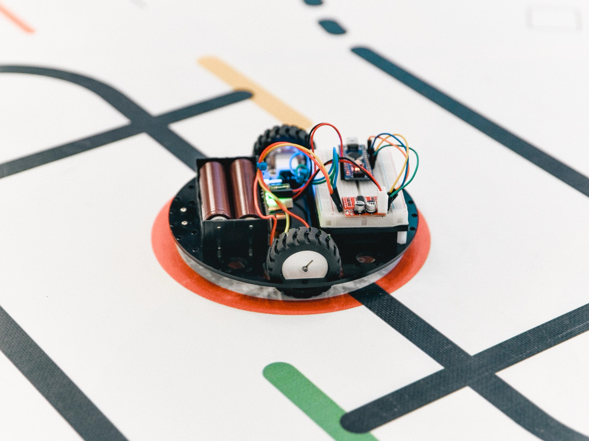

# Робототехника на Arduino Nano

Эти уроки рассчитаны на учеников 9 класса, которые прошли курс «Электротехника 8-9». Для работы вам понадобятся базовые команды Arduino и основы программирования на C/C++. Предполагается, что вы умеете объявлять переменные, выбирать типы данных, записывать математические выражения, использовать условия и циклы, а также объявлять и вызывать функции.

На двухколёсном роботе вы научитесь управлять моторами, настроите движение по линии, используя ПИД-прегулятор, а также получите расстояние с дальномера. В конце робот самостоятельно проедет «Шорт-трек» и выберет маршрут в зависимости от положения кубика на полигоне.

## Занятия

0. [Проверка робота](lesson-00-robot-test/README.md) — проверить шасси, датчики линии и дальномер.
1. [Питание и движение](lesson-01-movement/README.md) — задать движение вперёд, назад и поворот на месте.
2. [Движение по линии. ПД-регулятор](lesson-02-line-pd/README.md) — измерить ошибку и подобрать коэффициенты П и Д.
3. [Длинная дуга и перекрёстки](lesson-03-crossroads/README.md) — подобрать И-коэффициент и сосчитать перекрёстки.
4. [Дальномер и проверочная работа «Шорт-трек»](lesson-04-short-track/README.md) — остановиться на первом перекрёстке, выбрать путь по показаниям дальномера и доехать до финиша.

## Оборудование на одного робота

- Контроллер Arduino Nano, макетная плата, драйвер MX1508 — по одному.
- Моторы GA12-N20 на шасси диаметром 16 см.
- Модуль питания с фиксированным выходом DC 5,2 В, батарейный отсек, два аккумулятора 18650, выключатель и соединительные провода.
- Аналоговые датчики линии TCRT5000 — два. Ультразвуковой дальномер HC-SR04 — один.
- Для занятий понадобятся компьютер с Arduino IDE, USB-кабель и поле с чёрной линией. Для проверочной работы — пластиковый кубик с ребром 5 см.

## Как начать

Скачайте репозиторий через **Code → Download ZIP** и распакуйте архив. Подключите Arduino Nano по USB, в Arduino IDE выберите плату **Arduino Nano** и её порт. Начните с [проверки робота](lesson-00-robot-test/README.md).

В каждом уроке откройте стартовый скетч по ссылке в начале страницы. В разделе «Задания (TODO)» выберите пункт и найдите в скетче комментарий с тем же номером, например `// TODO 2`. Внесите изменение, загрузите скетч и сравните поведение робота с описанием в уроке.

Имена иллюстраций и видео в assets

Иллюстрации лежат в `assets/img/`, ролики — в `assets/video/`. Имя начинается с двузначного номера урока и обозначает то, что изображено. Кадр и ролик одной сцены имеют общее имя, например `02-line-error.png` и `02-line-error.mp4`. Фотография и обзор комплектующих относятся ко всему курсу и имеют префикс `robot-`.

## Исходные материалы робота

Робота можно собрать самостоятельно. В папке [assets/robot-source](assets/robot-source/) появятся исходные файлы робота и инструкции к ним (to be added).
