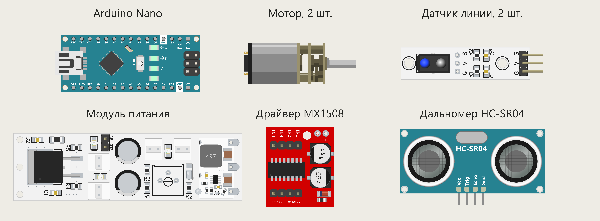

# Робототехника на Arduino Nano

Курс для 9 класса. На одном двухколёсном роботе вы проверите оборудование, научитесь управлять моторами и настроите движение по чёрной линии. В конце робот самостоятельно проедет «Шорт-трек» и выберет маршрут по показаниям дальномера.

## Занятия

0. [Проверка робота](lesson-00-robot-test/README.md) — испытать колёса, датчики линии и дальномер.
1. [Питание и движение](lesson-01-movement/README.md) — задать движение вперёд, назад и поворот на месте.
2. [Движение по линии. ПД-регулятор](lesson-02-line-pd/README.md) — измерить ошибку и подобрать коэффициенты П и Д.
3. [Длинная дуга и перекрёстки](lesson-03-crossroads/README.md) — подобрать И-коэффициент и считать въезды на перекрёстки.
4. [Дальномер и проверочная работа «Шорт-трек»](lesson-04-short-track/README.md) — обнаружить кубик и остановиться на финише.

## Оборудование на одного робота

- Контроллер Arduino Nano, макетная плата, драйвер MX1508 — по одному.
- Моторы GA12-N20 без энкодеров и колёса — по два. Шасси — одно.
- Аналоговые датчики линии TCRT5000 — два. Ультразвуковой дальномер HC-SR04 — один.
- Модуль питания с фиксированным выходом DC 5,2 В, батарейный отсек, два аккумулятора 18650, выключатель и соединительные провода.
- Для занятий понадобятся компьютер с Arduino IDE, USB-кабель и поле с чёрной линией. Для проверочной работы — пластиковый кубик с ребром 5 см.

## Как начать

Скачайте репозиторий через **Code → Download ZIP** и распакуйте архив. Подключите Nano по USB, в Arduino IDE выберите плату **Arduino Nano** и её порт. Начните с тестовой программы в занятии 0.

Имена иллюстраций и видео в assets

Иллюстрации лежат в `assets/img/`, ролики — в `assets/video/`. Имя начинается с двузначного номера урока и обозначает то, что изображено. Кадр и ролик одной сцены имеют общее имя, например `02-line-error.png` и `02-line-error.mp4`. Фотография и обзор комплектующих относятся ко всему курсу и имеют префикс `robot-`. Для фотографии используем JPG, для векторной схемы — SVG, для кадра — PNG, для видео — MP4.

