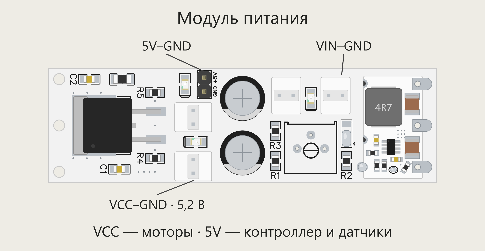
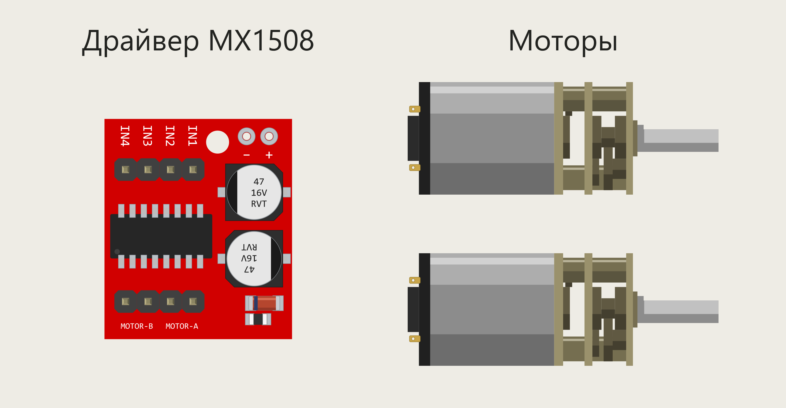

# Урок 01. Питание и движение

[← Урок 00](../lesson-00-robot-test/README.md) · [Оглавление](../README.md#занятия) · [Урок 02 →](../lesson-02-line-pd/README.md)

[Стартовый скетч для Arduino Nano](firmware/lesson-01-movement/lesson-01-movement.ino)

## Питание

Батарейный отсек питает модуль через вход VIN. Выход **DC (VCC) 5,2 В** питает силовую часть драйвера MX1508. Выход **5V** питает Nano и датчики. Земля общая: относительно неё контроллер задаёт уровни на входах драйвера.

## Как драйвер управляет мотором

На каждый мотор приходятся два входа драйвера. ШИМ на первом входе при нуле на втором задаёт вращение в одну сторону. Если поменять входы ролями, мотор вращается в другую сторону. Значение ШИМ определяет команду мотору; фактическая скорость зависит также от нагрузки.

## Подключение

На схеме верхний мотор подключён к выходу MOTOR-A (левое колесо робота), нижний — к MOTOR-B (правое колесо).

При выключенном питании сверьте группы соединений:

- Левый мотор: D11 → IN1, D6 → IN2. Правый мотор: D5 → IN3, D3 → IN4.
- Провода левого и правого моторов идут на выходы соответствующих каналов. Проверить стороны и направления можно вызовом `wheelsTest()` из урока 0.

## Функция motors()

Первый аргумент управляет левым мотором, второй — правым. Диапазон каждого — от −255 до 255. Плюс задаёт вращение вперёд, минус — назад, ноль выключает мотор. [Откройте реализацию функции](firmware/lesson-01-movement/lesson-01-movement.ino) и проследите, какие два входа получат ШИМ при вызове `motors(150, -150)`.

[Смотреть видео «Почему робот поворачивает»](https://alekseigrachev2002-maker.github.io/Arduino-Robotics-Lessons/assets/video/01-wheel-motion.mp4)

## Задания (TODO)

1. Научите робота ехать прямо. Проведите два заезда от одной отметки за одинаковое время. Если робота уводит в сторону, скорректируйте ШИМ одного колеса и сохраните удачную пару значений.
2. Научите робота поворачивать на месте на 90° влево или вправо. Подберите длительность поворота и остановите моторы.
3. Дополнительно. Проедьте по квадрату. Повторите прямой участок и поворот четыре раза, остановитесь и сравните точку остановки со стартом.

### С чем сравнить результат

На одном заряде провели два заезда по 3 секунды. При ШИМ 70 после разгона левое колесо двигалось со скоростью около 29 см/с, а правое — около 24 см/с. Правое колесо было примерно на 20 % медленнее левого. При ШИМ 150 скорости составили около 49 и 47 см/с соответственно, а разница сократилась примерно до 5 %. Сравните, при каком ШИМ вашего робота сильнее уводит в сторону.

После отключения моторов при ШИМ 150 робот проехал ещё около 13 см. Учитывайте этот выбег при выборе точки остановки.

Если вместо поворота на месте робот едет прямо, проверьте знаки аргументов `motors()`: для разворота колёса должны вращаться в разные стороны.

[← Урок 00](../lesson-00-robot-test/README.md) · [Оглавление](../README.md#занятия) · [Урок 02 →](../lesson-02-line-pd/README.md)
