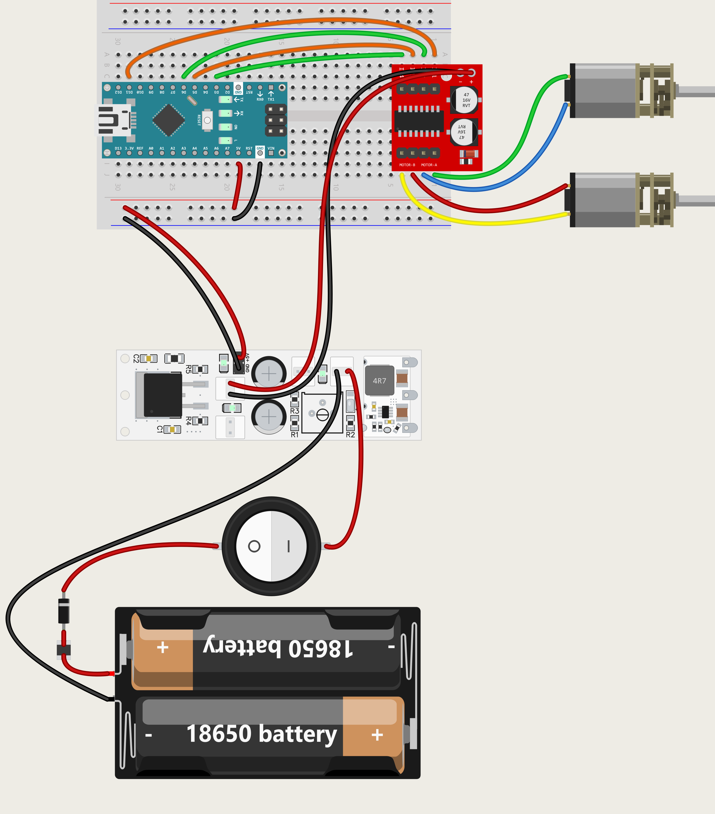
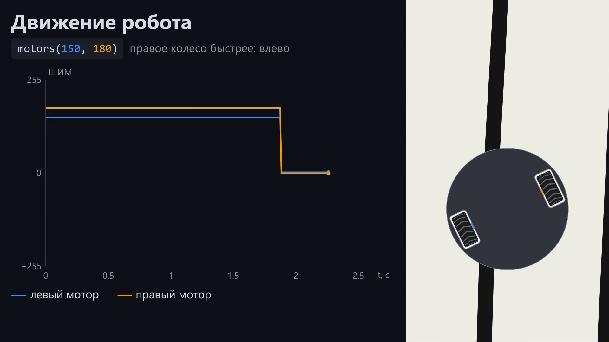

# Урок 01. Питание и движение

[← Урок 00](../lesson-00-robot-test/README.md) · [Оглавление](../README.md#занятия) · [Урок 02 →](../lesson-02-line-pd/README.md)

## Питание

Батарейный отсек питает модуль через вход VIN. Выход **DC (VCC) 5,2 В** питает силовую часть драйвера MX1508. Выход **5V** питает Arduino Nano и датчики. Линия GND (земля, минус питания) общая: относительно неё контроллер задаёт уровни на входах драйвера.

## Как драйвер управляет мотором

Каждым мотором управляют два входа драйвера. Для левого мотора это IN1 и IN2. Если подать ШИМ на IN1, а на IN2 — ноль, левое колесо будет вращаться вперёд. Чтобы оно вращалось назад, подайте ШИМ на IN2, а на IN1 оставьте ноль. Значение (скважность) ШИМ определяет напряжение, подаваемое на мотор; фактическая скорость зависит также от нагрузки.

## Подключение

На схеме верхний мотор подключён к выходу MOTOR-A (левое колесо робота), нижний — к MOTOR-B (правое колесо).

При выключенном питании сверьте группы соединений:

- Левый мотор: D11 → IN1, D6 → IN2. Правый мотор: D5 → IN3, D3 → IN4.
- Провода левого и правого моторов идут на выходы соответствующих каналов. Проверить стороны и направления можно вызовом `wheelsTest()` из урока 0.

## Функция motors()

Первый аргумент управляет левым мотором, второй — правым. Диапазон скорости каждого мотора — от −255 до 255. Знак аршкмента задаёт вращение: плюс — вперёд, минус — назад, ноль выключает мотор. Откройте реализацию функции и проследите, какие два входа получат ШИМ при вызове `motors(150, -150)`.

[Смотреть видео «Почему робот поворачивает»](https://alekseigrachev2002-maker.github.io/Arduino-Robotics-Lessons/assets/video/01-wheel-motion.mp4)

## Задания (TODO)

1. Научите робота двигаться прямо. Проведите два заезда от одной отметки за одинаковое время. Если робота уводит в сторону, скорректируйте ШИМ одного колеса.
2. Научите робота поворачивать на месте на 90° влево или вправо. Подберите длительность поворота и остановите моторы.
3. Дополнительно. Научите робота двигаться по квадрату. Повторите прямой участок и поворот четыре раза.

[Скетч-заготовка для базового движения](firmware/lesson-01-movement/lesson-01-movement.ino)

### Как скорость колёс зависит от ШИМ

Один из роботов испытали в двух заездах. В каждом из них на оба мотора подавали одинаковый ШИМ-сигнал. При ШИМ 70 после разгона скорость левого колеса была около 29 см/с, правого — около 24 см/с. При ШИМ 150 левое колесо разогналось примерно до 49 см/с, правое — до 47 см/с.

При ШИМ 70 правое колесо вращалось примерно на 20 % медленнее левого, а при ШИМ 150 — всего на 5 %. Проверьте на своём роботе, при каком из этих двух значений ШИМ он сильнее отклоняется от прямой. В заезде с ШИМ 150 робот после выключения моторов проехал по инерции ещё около 13 см. Учитывайте этот выбег, когда выбираете, где подать команду остановки.

[← Урок 00](../lesson-00-robot-test/README.md) · [Оглавление](../README.md#занятия) · [Урок 02 →](../lesson-02-line-pd/README.md)
