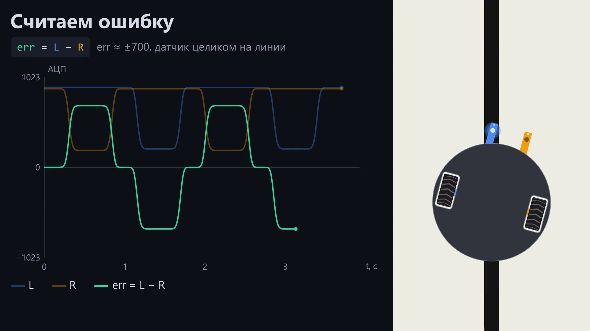
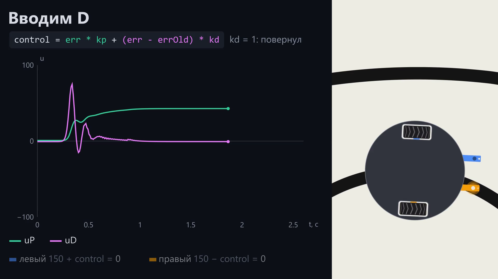

# Урок 02. Движение по линии. ПД-регулятор

[Стартовый скетч для Arduino Nano](firmware/lesson-02-line-pd/lesson-02-line-pd.ino)

## Датчики линии

<p align="center"></p>

## Измерьте ошибку

Левый датчик подключён к A0, правый — к A1. В стартовом скетче уже включена функция `sensors()`. Откройте плоттер порта на скорости 9600. Запишите показания обоих датчиков на белом и на чёрном. Затем медленно проведите линию сначала под левым, потом под правым датчиком. Как меняется знак третьей кривой?

<p align="center"></p>

[Смотреть видео «Ошибка положения на линии»](../assets/video/02-line-error.mp4)

Примем `err = L - R`. Когда левый датчик видит чёрное, а правый — белое, ошибка отрицательна. Робот должен повернуть влево: левое колесо замедляется, правое ускоряется.

## Сначала П, затем Д

П-составляющая даёт поправку, пропорциональную отклонению. При `kd = 0` проверьте знак на поднятых колёсах. Затем на одной и той же базовой скорости подберите `kp`: сравнивайте поведение на прямой и на самом крутом повороте.

<p align="center"></p>

[Смотреть видео «Подбор П-коэффициента»](../assets/video/02-proportional.mp4)

Д-составляющая учитывает изменение ошибки между соседними измерениями. Она помогает погасить раскачку, когда робот возвращается к линии.

<p align="center"></p>

[Смотреть видео «Добавление Д-составляющей»](../assets/video/02-derivative.mp4)

## Один шаг регулятора

Найдите `followLine()` в стартовом скетче. Найдите строку, где вычисляется `dErr`. Почему важно вычислить разность до того, как новая ошибка записана в `errOld`? Задержка `delay(10)` внутри функции задаёт паузу до следующего измерения. На время езды отключите вывод в порт: он меняет длительность шага.

```cpp
void followLine() {
  const int16_t speed = 150;
  const float kp = 0.1;  // TODO 3: подберите коэффициент на повороте.
  const float kd = 0.0;  // TODO 4: погасите раскачку на выходе.
  static int16_t errOld = 0;  // ошибка на предыдущем шаге

  // Ошибка положения: показание левого датчика минус показание правого.
  int16_t err = analogRead(LEFT_SENS) - analogRead(RIGHT_SENS);

  // Для Д-составляющей находим изменение ошибки за один шаг.
  int16_t dErr = err - errOld;
  errOld = err;  // запоминаем ошибку для следующего шага

  // Управляющее воздействие: поправку прибавляем к скорости левого колеса
  // и вычитаем из скорости правого.
  float control = kp * err + kd * dErr;
  motors(speed + control, speed - control);
  delay(10);
}
```

**Проверка.** Сначала добейтесь уверенного подруливания в сторону линии. Затем подберите `kd`, чтобы робот проходил поворот и выходил на прямую без повторной раскачки. Запишите `speed`, `kp`, `kd` и задержку для следующего урока.

## Задания (TODO)

1. Запишите L, R и L − R в плоттере на белом и чёрном.
2. Отключите `sensors()` и включите `followLine()`. При поднятых колёсах подведите чёрную линию под левый датчик. Левое колесо должно вращаться медленнее правого. Повторите проверку для правого датчика.
3. При kd = 0 подберите kp для самого крутого поворота.
4. Подберите kd для выхода на прямую без раскачки. Сохраните настройки и шаг цикла.

[К оглавлению](../README.md)
