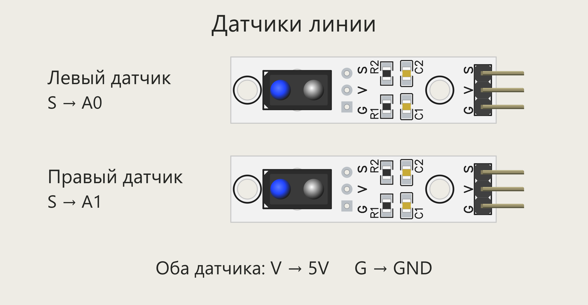
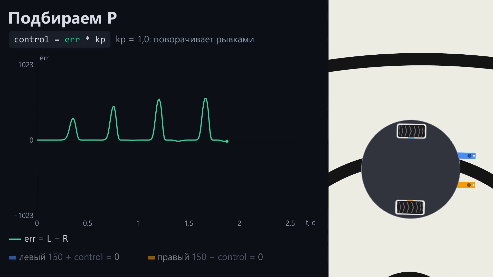

# Урок 02. Движение по линии. ПД-регулятор

[← Урок 01](../lesson-01-movement/README.md) · [Оглавление](../README.md#занятия) · [Урок 03 →](../lesson-03-crossroads/README.md)

## Датчики линии

<p align="center"></p>

## Измерьте ошибку

Левый датчик подключен к A0, правый — к A1. В стартовом скетче уже включена функция `sensors()`. Откройте плоттер порта и выберите скорость 9600 бод. Запишите показания обоих датчиков на белом фоне и на черной линии. Медленно переместите робота так, чтобы черная линия оказалась сначала под левым датчиком, затем под правым. Посмотрите на график разности `L - R`. Что определяет знак и значение разности `L - R`?

<p align="center"></p>

[Смотреть видео «Ошибка положения на линии»](https://alekseigrachev2002-maker.github.io/Arduino-Robotics-Lessons/assets/video/02-line-error.mp4)

Обозначим показания левого и правого датчиков как `L` и `R`. Разность `err = L - R` будем называть ошибкой положения. По этой ошибке ПИД-регулятор вычисляет поправку к командам моторов, чтобы робот двигался по линии.

Название «ПИД» образовано от названий трех составляющих регулятора: пропорциональной (П), интегральной (И) и дифференциальной (Д). Задача настройки — подобрать коэффициент для каждой из них. В этом уроке вы подберете `kp` и `kd`, чтобы робот вписывался в поворот и не раскачивался. В следующем уроке вы настроите `ki`, чтобы робот держался ближе к середине линии на длинной дуге.

На черной линии показание датчика меньше, чем на белом фоне. Когда левый датчик видит черное, а правый — белое, ошибка отрицательна. Робот должен подрулить влево, поэтому левое колесо должно вращаться медленнее правого. Когда правый датчик видит черное, а левый — белое, ошибка положительна. Тогда правое колесо должно вращаться медленнее левого, чтобы робот подрулил вправо.

## Сначала П, затем Д

Начните с нулевых коэффициентов. При `kp = 0` и `kd = 0` ошибка уже измеряется, но на команды моторам она пока не влияет. Поставьте робота перед поворотом. Сначала увеличивайте только `kp` с шагом от `0.05` до `0.1`. Оставьте то значение, при котором робот только начинает вписываться в самый крутой поворот.

<p align="center"></p>

[Смотреть видео «Подбор П-коэффициента»](https://alekseigrachev2002-maker.github.io/Arduino-Robotics-Lessons/assets/video/02-proportional.mp4)

Теперь понемногу увеличивайте `kd`. Д-составляющая реагирует на изменение ошибки между двумя измерениями. Повторяйте заезд на том же повороте, сохраняя скорость, значение `kp` и задержку `delay(10)`. Подберите `kd`, при котором робот проходит поворот и выходит на прямую без повторной раскачки. Значения коэффициентов на рисунках относятся к модели. У вашего робота они могут отличаться. Величину `kd` стоит искать с шагом `0.1`.

<p align="center"></p>

[Смотреть видео «Добавление Д-составляющей»](https://alekseigrachev2002-maker.github.io/Arduino-Robotics-Lessons/assets/video/02-derivative.mp4)

## Один шаг регулятора

В стартовом скетче найдите функцию `followLine()` и строку, в которой вычисляется `dErr`. Почему важно вычислить разность до того, как новая ошибка записана в `errOld`? Задержка `delay(10)` внутри функции задает паузу до следующего измерения. Во время движения отключите вывод в порт: он меняет длительность шага.

```cpp
void followLine() {
  const int16_t speed = 150;
  const float kp = 0.0;  // TODO 3: при нулевом kd увеличивайте kp, пока робот не начнет вписываться в поворот.
  const float kd = 0.0;  // TODO 4: сохраните kp и подберите kd, чтобы погасить раскачку.
  static int16_t errOld = 0;  // ошибка на предыдущем шаге

  int16_t err = analogRead(LEFT_SENS) - analogRead(RIGHT_SENS);

  // Для Д-составляющей находим изменение ошибки за один шаг.
  int16_t dErr = err - errOld;
  errOld = err;  // запоминаем ошибку для следующего шага

  // Управляющее воздействие: поправку прибавляем к скорости левого колеса
  // и вычитаем из скорости правого.
  float control = kp * err + kd * dErr;
  motors(speed + control, speed - control);
  delay(10);
}
```

На что влияет параметр `speed`? Как робот будет проходить поворот при `speed = 255`? Как на движение по линии влияют длительность задержки `delay()` и коэффициенты `kp` и `kd`? Запомните, как вы подбирали эти параметры. Это пригодится в следующем уроке.

## Задания (TODO)

1. Измерьте `L`, `R` и их разность на белом и черном. По очереди подведите линию под левый и правый датчики и сравните знаки ошибки в этих двух положениях.
2. Отключите `sensors()` и включите `followLine()`. Поднимите колеса. По коду определите, какую команду получает каждое колесо при нулевых коэффициентах. Проверьте, меняется ли вращение, когда вы подводите линию под датчик.
3. Оставьте `kd = 0` и задайте небольшое положительное `kp`. Проверьте знак на поднятых колесах: при линии под левым датчиком левое колесо должно замедлиться относительно правого. На трассе повышайте `kp`, пока робот не начнет вписываться в поворот.
4. Сохраните найденное `kp` и подберите `kd`, чтобы погасить раскачку на том же повороте. Запишите настройки и шаг цикла.

[Скетч-заготовка для ПД-регулятора](firmware/lesson-02-line-pd/lesson-02-line-pd.ino)

[← Урок 01](../lesson-01-movement/README.md) · [Оглавление](../README.md#занятия) · [Урок 03 →](../lesson-03-crossroads/README.md)
