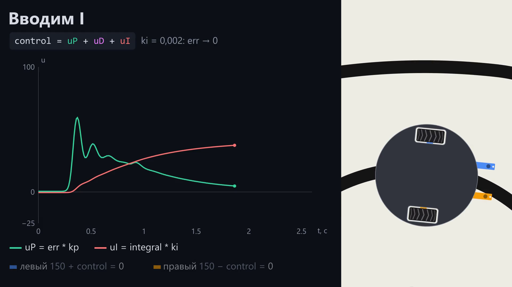
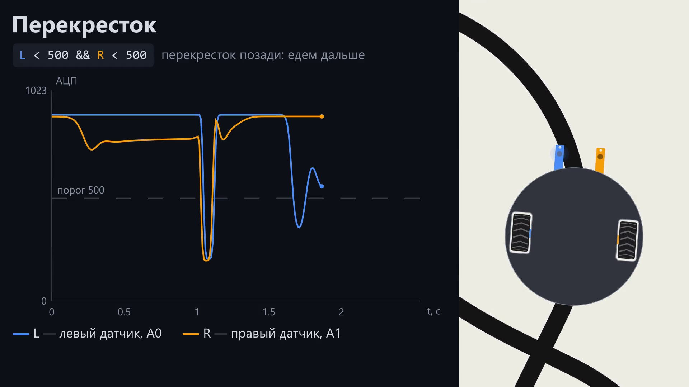

# Урок 03. Длинная дуга и перекрёстки

[← Урок 02](../lesson-02-line-pd/README.md) · [Оглавление](../README.md#занятия) · [Урок 04 →](../lesson-04-short-track/README.md)

## Зачем на длинной дуге нужен И-коэффициент

В некоторых системах коэффицентов П и Д может не хватить. Например, на длинной дуге внешнее колесо должно всё время вращаться быстрее внутреннего. Когда робот едет вдоль дуги с постоянным смещением, ошибка почти не меняется, и Д-составляющая близка к нулю. Нужную разницу скоростей поддерживает П-составляющая. Чем круче дуга, тем больше нужна поправка, и с одним ПД-регулятором робот проходит поворот со смещением относительно середины линии.

И-составляющая учитывает, как долго робот едет со смещением. На каждом шаге к накопленной сумме прибавляется текущая ошибка. Пока робот двигается преимущественно с одной стороны от середины линии, ошибки одного знака складываются и поправка постепенно растёт. Робот смещается ближе к середине. Текущая ошибка уменьшается, зато накопленная сумма сохраняет разницу скоростей колёс, нужную для поворота. На рисунке видно, как вклад П уменьшается, а вклад И растёт.

<p align="center"></p>

[Смотреть видео «Как накапливается поправка на дуге»](https://alekseigrachev2002-maker.github.io/Arduino-Robotics-Lessons/assets/video/03-integral.mp4)

### Подберите `ki`

В стартовом скетче уже есть функция `followLine()` с ПИД-регулятором. Как и в уроке 02, `dErr` показывает, насколько ошибка изменилась за один шаг. Новая переменная `integral` хранит сумму ошибок между вызовами функции. Коэффициент `ki` определяет, какую поправку эта сумма добавляет к командам колёс.

```cpp
void followLine() {
  // TODO 1: перенесите настройки ПД из урока 02 и подберите ki на длинной дуге.
  const int16_t speed = 150;
  const float kp = 0.0;
  const float kd = 0.0;
  const float ki = 0.0;
  static int16_t errOld = 0;    // ошибка на предыдущем шаге
  static float integral = 0.0;  // сумма ошибок с начала заезда

  // Ошибка положения: показание левого датчика минус показание правого.
  int16_t err = analogRead(LEFT_SENS) - analogRead(RIGHT_SENS);

  // Для Д-составляющей находим изменение ошибки, для И-составляющей накапливаем сумму.
  int16_t dErr = err - errOld;
  errOld = err;
  integral = integral + err;

  // Управляющее воздействие складывается из трёх составляющих: П, И и Д.
  float control = kp * err + ki * integral + kd * dErr;
  int16_t left = constrain(speed + control, -255, 255);
  int16_t right = constrain(speed - control, -255, 255);
  motors(left, right);
  delay(10);
}
```

Перенесите из урока 02 свои значения `speed`, `kp`, `kd` и длительность задержки в `delay()`. Проведите два заезда по одной дуге с одной и той же стартовой отметки. В первом оставьте `ki = 0.0`, во втором задайте небольшое положительное `ki`. Подбирать `ki` нужно с шагом 0,001–0,005, значеительно меньшим, чем для `kp` и `kd`. Сравните, насколько робот смещён от середины линии на дуге и как он выходит на прямую. Если после выхода на прямую робот продолжает поворачивать в прежнюю сторону, уменьшите `ki`.

## Как посчитать один перекрёсток

<p align="center"></p>

[Смотреть видео «Два датчика над перекрёстком»](https://alekseigrachev2002-maker.github.io/Arduino-Robotics-Lessons/assets/video/03-crossing.mp4)

На перекрёстке оба датчика одновременно видят чёрное. Пока робот проезжает полосу, это условие выполняется несколько раз подряд. Счётчик должен сработать только при въезде: сейчас оба датчика видят чёрное, а на предыдущем шаге хотя бы один из них видел белое.

1. По измерениям урока 02 выберите общий порог, который отделяет чёрное от белого для обоих датчиков.
2. В стартовой функции `crossRoad()` оставлены три логические ошибки. Проследите, что она вернёт при нескольких вызовах подряд над одной полосой и при въезде на следующую. Исправьте функцию так, чтобы каждый новый въезд добавлял ровно один перекрёсток.
3. Проверьте счётчик на столе. Для этого в `loop()` временно замените `followLine();` на `motors(0, 0);` и раскомментируйте `Serial.println(crossings);`. Загрузите скетч, откройте монитор порта на скорости **9600 бод** и начните с обоих датчиков над белым. При первом переходе на чёрное показание меняется с 0 на 1 и остаётся равным 1, пока вы держите датчики над полосой. Уведите оба датчика на белое и верните на чёрное. Теперь показание должно стать 2.
4. Для заезда верните `followLine();`, снова закомментируйте вывод в порт и загрузите скетч.
5. Задайте остановку на пятом перекрёстке. До него вызывайте `followLine()`, при достижении цели — `motors(0, 0)`. Проверьте, что следующий проход `loop()` сохраняет остановку.

## Задания (TODO)

1. Перенесите настройки ПД из урока 02. Подберите `ki` на длинной дуге, сравнив заезды с нулевой и ненулевой И-составляющей.
2. Выберите порог чёрного по измерениям обоих датчиков.
3. Исправьте три ошибки в `crossRoad()`. Проверьте на столе, что один въезд даёт один отсчёт, а удержание над чёрным не меняет показание.
4. Остановитесь на пятом перекрёстке и сохраните остановку при следующих вызовах `loop()`.

[Скетч-заготовка для ПИД-регулятора и подсчёта перекрёстков](firmware/lesson-03-crossroads/lesson-03-crossroads.ino)

[← Урок 02](../lesson-02-line-pd/README.md) · [Оглавление](../README.md#занятия) · [Урок 04 →](../lesson-04-short-track/README.md)
