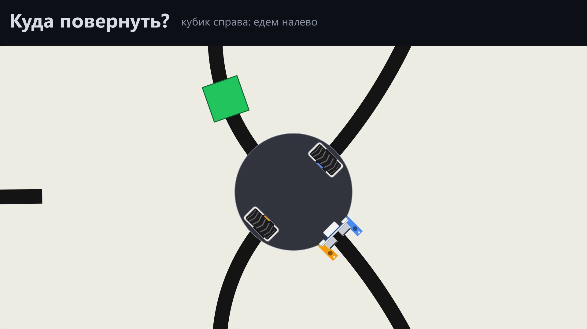

# Урок 04. Дальномер и проверочная работа «Шорт-трек»

[← Урок 03](../lesson-03-crossroads/README.md) · [Оглавление](../README.md#занятия)

## Как работает HC-SR04

<p align="center"></p>

Подключите VCC к 5V, а GND к GND на Nano. Для TRIG и ECHO подойдут два свободных цифровых пина. Например, в скетче курса TRIG подключён к D12 (выход), ECHO — к D13 (вход). Контроллер посылает на TRIG короткий импульс. Дальномер излучает ультразвук и выдаёт на ECHO импульс, длительность которого соответствует времени пути звука до препятствия и обратно. Режим работы пинов уже настроены в функции `setup()`: `pinMode(TRIG, OUTPUT)` и `pinMode(ECHO, INPUT)`.

Функция `pulseIn()` измеряет длительность эха в микросекундах. При комнатной температуре скорость звука в воздухе около 343 м/с. В метре 100 см, а в секунде 10⁶ мкс, поэтому скорость звука равна примерно 343 × 100 / 10⁶ = 343 / 10⁴ = 0,0343 см/мкс. За время эха звук проходит путь до препятствия и обратно, поэтому расстояние до препятствия равно половине этого пути.

**Расстояние в сантиметрах = время эха в микросекундах × 343 / (2 × 10⁴).** Например, эхо длительностью 1000 мкс соответствует расстоянию 17,15 см. Отсюда и привычный делитель 58: для препятствия на расстоянии 1 см эхо длится примерно 58 мкс.

### Проверка дальномера

В стартовом скетче этого урока функция `distanceCm()` возвращает расстояние в сантиметрах. В `loop()` уже включён вывод её результата в монитор порта.

```cpp
float distanceCm() {
  digitalWrite(TRIG, LOW);
  delayMicroseconds(2);
  digitalWrite(TRIG, HIGH);
  delayMicroseconds(10);
  digitalWrite(TRIG, LOW);

  uint32_t duration = pulseIn(ECHO, HIGH, 30000);  // длительность эха в мкс
  return duration * 343.0 / (2.0 * 10000.0);
}
```

Если за 30 мс эхо не пришло, функция возвращает 0.

## Проверочная работа «Шорт-трек»

Разработайте программу для трёх заездов по полю «Шорт-трек». Перед стартом пластиковый кубик с ребром 5 см ставят на одну из боковых ветвей нижнего X-перекрёстка или оставляют поле свободным. Во всех заездах робот работает по одной программе.

<p align="center"></p>

Старт и финиш совмещены на поперечной отметке верхней внешней прямой. Робот начинает движение **по часовой стрелке** (вправо по рисунку), едет по линии и останавливается на первом перекрёстке — нижнем X. Здесь он обследует дальномером три направления. Если кубик слева, робот поворачивает направо. Если кубик справа, поворачивает налево. Если кубика нет, продолжает движение прямо. Стороны определяются при подъезде к перекрёстку.

**Заезд засчитан**, если робот самостоятельно выбрал нужную ветвь, доехал по линии до финишной отметки и остался на ней. Кубик должен остаться на месте.

<p align="center"></p>

[Смотреть видео «Зелёный кубик справа — робот поворачивает налево»](https://alekseigrachev2002-maker.github.io/Arduino-Robotics-Lessons/assets/video/04-green-cube.mp4)

## Задания (TODO)

1. **Подберите порог обнаружения кубика.** Оставьте робота на месте и откройте монитор порта на скорости 9600. Сравните показания `distanceCm()` для кубика и свободной ветви, затем выберите порог. Учтите, что нулевое показание означает отсутствие эха.
2. **Добейтесь остановки на первом перекрёстке X.** Перенесите из своего решения урока 03 функцию `followLine()` с И-составляющей, скоростью, коэффициентами и задержкой, а также `crossRoad()` со своим порогом чёрного. В `loop()` замените вывод расстояния и паузу движением по линии. Задайте остановку при первом въезде на X. Стартовая отметка в счёт не входит.
3. **Запрограммируйте выбор ветви.** После остановки на X по очереди направьте дальномер налево, направо и вперёд. По измерениям выберите направление согласно условию заезда и выведите робота на выбранную линию.
4. **Задайте остановку на финише.** Считайте новые въезды после выезда с X. После поворота налево остановитесь на первом следующем перекрёстке. После поворота направо или проезда прямо финиш будет третьим: сначала робот пересечёт поперечную отметку на внутренней линии, затем повторно проедет X прямо и встретит финишную отметку на внешней линии.
5. **Проверьте одну программу в трёх заездах.** Поставьте кубик сначала слева, затем справа, а в третьем заезде уберите его. Каждый раз проверьте остановку на первом X, выбор ветви и окончательную остановку на финише.

[Скетч-заготовка для «Шорт-трека»](firmware/lesson-04-short-track/lesson-04-short-track.ino)

[← Урок 03](../lesson-03-crossroads/README.md) · [Оглавление](../README.md#занятия)
