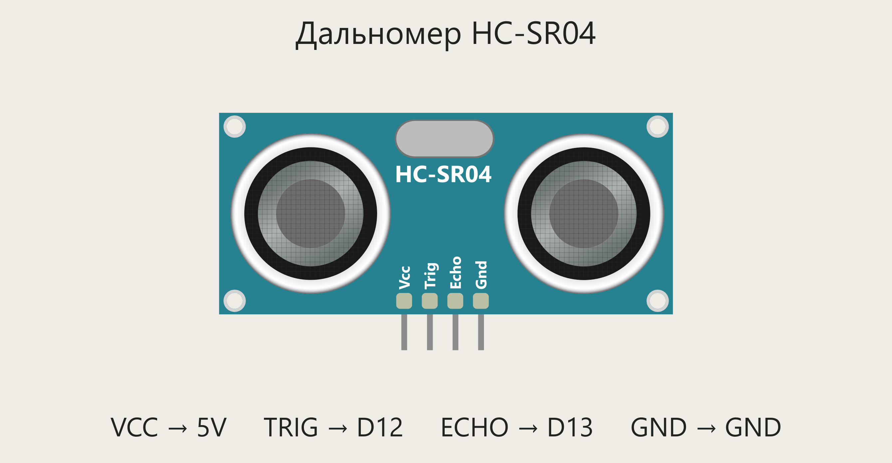
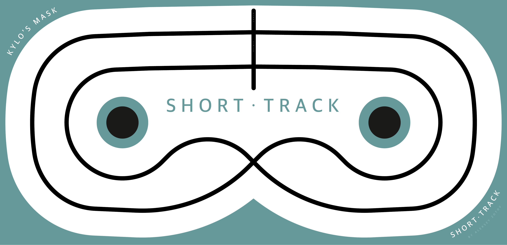

# Урок 04. Дальномер и проверочная работа «Шорт-трек»

[Стартовый скетч для Arduino Nano](firmware/lesson-04-short-track/lesson-04-short-track.ino)

## Как работает HC-SR04

<p align="center"></p>

Подключение к Nano: **VCC → 5V**, **GND → GND**, **TRIG → D12**, **ECHO → D13**. Контроллер посылает на TRIG короткий импульс. Дальномер излучает ультразвук и выдаёт на ECHO импульс, длительность которого соответствует времени пути звука до препятствия и обратно.

### Проверка дальномера

Эта функция из [тестового скетча](../lesson-00-robot-test/firmware/lesson-00-robot-test/robot-test.cpp) выводит результат в сантиметрах:

```cpp
void distance() {  // расстояние до препятствия в сантиметрах
  digitalWrite(TRIG, LOW);
  delayMicroseconds(2);
  digitalWrite(TRIG, HIGH);  // импульс 10 мкс запускает измерение
  delayMicroseconds(10);
  digitalWrite(TRIG, LOW);

  uint32_t duration = pulseIn(ECHO, HIGH, 30000);  // время эха, мкс; ждем не дольше 30 мс, нет эха - 0
  Serial.print("см ");
  Serial.println(duration / 58);  // звук проходит 1 см туда и обратно примерно за 58 мкс
}
```

Включите `distance()` в уроке 0 и откройте монитор порта на 9600. Сравните показания напротив плоской грани кубика и при свободном направлении. При тайм-ауте `pulseIn()` возвращает ноль. Для проверочной работы используйте измерение в программе: условие обнаружения должно учитывать и наличие эха, и выбранный порог расстояния.

## Проверочная работа «Шорт-трек»

Для этой работы откройте рядом свой скетч из урока 03. Возьмите из него `followLine()` с подобранными скоростью, шагом цикла и коэффициентами, а также `crossRoad()` со своим порогом чёрного. Уберите условие остановки на пятом перекрёстке из предыдущего маршрута. Здесь место остановки задаёт выбранная ветвь. Сначала завершите измерения с неподвижным роботом (TODO 1), затем замените диагностический цикл в `loop()` (TODO 2).

<p align="center"></p>

Стартуйте с верхней внешней прямой. Направление движения — **по часовой стрелке**, вправо от стартовой отметки. До старта по жребию ставят пластиковый кубик с ребром 5 см на одну из боковых ветвей у нижнего X-перекрёстка. Стороны определяются **по ходу робота при подъезде к X**.

Доедьте до X по линии, определите дальномером, с какой стороны кубик, и выберите свободную ветвь. Кубик должен остаться на месте. При объезде кубика финиш — на стартовой отметке внешней прямой.

- Кубик **справа**: поверните налево. 
- Кубик **слева**: поверните направо. 
- **Дополнительно.** Если кубика нет, пройдите X прямо и остановитесь на **третьем** следующем перекрёстке.

Для одного объезда финиш приходится на первый перекрёсток, для другого — на третий. Проследите обе ветви на рисунке до стартовой отметки и определите число для каждой. Начинайте отсчёт после выезда с X. Если маршрут позже снова приводит на X, этот въезд учитывается.

<p align="center"></p>

[Смотреть видео «Зелёный кубик справа — робот поворачивает налево»](../assets/video/04-green-cube.mp4)

## Задания (TODO)

1. Измерьте расстояние до грани кубика и показания при свободном направлении. Выберите порог.
2. Перенесите регулятор и счётчик. Доедьте от старта по часовой стрелке до нижнего X.
3. Обследуйте обе боковые ветви дальномером и поверните в свободную сторону.
4. Начните отсчёт после выезда с X и остановитесь на финише. Проверьте оба положения кубика.
5. Дополнительно: при свободных боковых ветвях езжайте прямо до третьего следующего перекрёстка.

**Критерий выполнения.** Одна и та же программа справляется с обоими положениями кубика: робот выбирает нужную ветвь, проходит её по линии и самостоятельно останавливается на финише.

[К оглавлению](../README.md)
